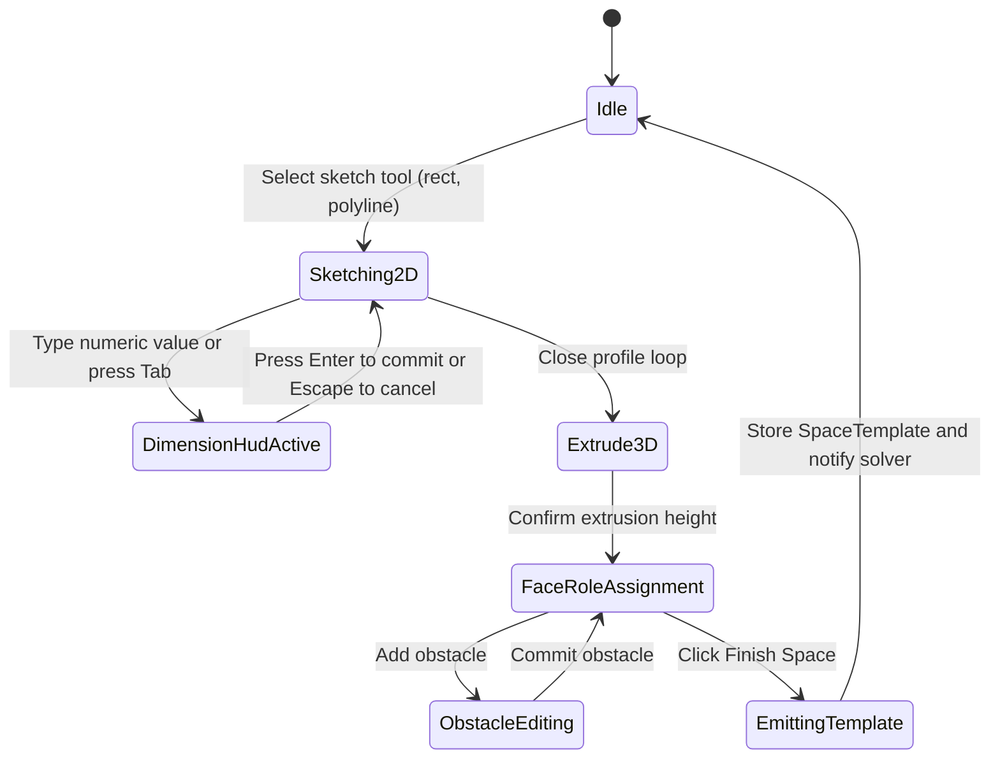

# Architecture spike: Space Modeler CAD UX and SpaceTemplate contract

## Context

This document specifies the Space Modeler CAD user experience and the data contract for issue `sm-54wg.3`.
It adapts browser modeling patterns from Autodesk Fusion for [apps/web](file:///home/mkobit/workspace/mkobit/storagemaxxing/apps/web) and [packages/geometry](file:///home/mkobit/workspace/mkobit/storagemaxxing/packages/geometry).
The modeler decouples 3D void modeling from combinatorial bin packing solvers.

```
+--------------------------------------------------------------------+
| Space Modeler CAD UX (apps/web)                                     |
| 1. 2D sketch on orthographic grid with dynamic tape measure        |
| 2. Floating dimension HUD with fractional keyboard entry           |
| 3. Extrusion to 3D void via normal arrow drag gizmo                |
| 4. Interactive face role assignment (access, gravity, obstacles)   |
+--------------------------------------------------------------------+
                                  |
                                  | Emits immutable SpaceTemplate JSON
                                  v
+--------------------------------------------------------------------+
| SpaceTemplate contract (packages/assembly, packages/geometry)      |
| - 2D polygon footprint or bounding box                             |
| - 3D extrusion height and normal                                   |
| - Access face and reach clearance buffer                           |
| - Obstacles, dividers, and installation constraints                |
+--------------------------------------------------------------------+
                                  |
                 +----------------+----------------+
                 |                                 |
                 v                                 v
+--------------------------------+ +--------------------------------+
| Layer 1 MaxRects solver        | | Layer 2 OR-Tools CP-SAT solver |
| (packages/packer synchronous)  | | (Web Worker WASM via sm-54wg.4)|
+--------------------------------+ +--------------------------------+
```

## Autodesk Fusion CAD interaction model

Autodesk Fusion uses a direct sketch-to-feature modeling pipeline.
StorageMaxxing simplifies this pipeline for storage enclosures.
The user does not construct complex solid B-Rep geometry.
The user defines an extruded void volume that holds modular bins.

### Orthographic canvas

The modeler provides two view modes.
In sketch mode, the camera uses an orthographic projection aligned with the active sketch plane normal vector.
In extrusion mode, the camera transitions smoothly to an axonometric 30-degree isometric elevation.
The canvas transforms screen pixels to world inches with 1/16-inch fractional resolution.

### Dynamic tape-measure grid

The canvas renders an adaptive Cartesian grid.
The grid subdivides dynamically based on the camera zoom scale:

- Coarse zoom: 6-inch and 2-inch major intervals.
- Medium zoom: 1-inch and 1/2-inch intervals.
- Close zoom: 1/4-inch, 1/8-inch, and 1/16-inch intervals.

Ruler bands display on the top horizontal axis and left vertical axis.
The ruler bands display mixed fractional annotations such as `14 3/8"`.
A magnetic snap engine snaps cursor coordinates to active grid ticks within an 8-pixel radius.
Angle snapping locks lines to 0, 45, 90, 135, and 180 degrees.

### Dimension HUD

The canvas renders an inline floating heads-up display beside active geometry elements.
The HUD contains numeric input fields for active segment length, width, and angle.
Users can draw by pointer drag or by direct numeric entry.

HUD keyboard controls:

- `Tab`: Cycle focus between dimension input fields.
- `Enter`: Commit typed dimension value and create geometry element.
- `Escape`: Cancel current drag operation or revert input.
- Numeric keys: Start typing immediately to set length without manual input click.

Supported dimension formats:

- Fractional inches: `14 3/8`, `15 1/2"`, `24`.
- Decimal inches: `14.375`.
- Metric millimeters: `365mm` (automatically converts to inches).

### 3D extrusion drag gizmo

When the user closes a 2D sketch loop, the canvas displays a shaded profile face.
The viewport transitions to the isometric view.
A single-axis translation gizmo appears at the centroid of the profile face.
The gizmo displays a directional arrow along the positive normal axis.

Gizmo interaction controls:

- Pointer hover over arrow: Arrow highlights with accent color.
- Pointer drag along arrow axis: Extrudes footprint into 3D volume in real time.
- Floating extrusion badge: Displays current height in inches.
- Snap steps: Extrusion snaps to 1/8-inch increments or standard drawer depths (e.g. 2", 3", 4", 6").
- Double click arrow: Opens inline input field for direct height entry.

### Face role assignment

After extrusion, the user configures semantic roles for all faces of the void:

1. **Access face**:
   The user clicks the face through which hands reach into the storage unit.
   Options: `top` (drawers), `front` (shelves and cubbies), `top+front`, `all-sides`.
   Default: `top` if normal is $+Z$, `front` if normal is $+Y$.

2. **Gravity face**:
   The support surface on which bins rest.
   Default: Bottom face ($-Z$).

3. **Keep-out zones and obstacles**:
   Users can add box obstacles (e.g. plumbing pipes, drawer slide hardware).
   Users click a face, sketch an obstacle footprint, and set obstacle depth.
   The obstacle creates a bounding box excluded from bin placement.

4. **Dividers**:
   Users can place thin planar internal dividers along $X$, $Y$, or $Z$ axes.

5. **Installation constraints**:
   Users select mounting walls to declare constraints (`noDrill`, `noAdhesive`, `maxWeightLbs`, `railPresent`).

## State machine transitions



### State transition table

| Source state         | Trigger / event                    | Target state         | Action / guard                                                                                           |
| :------------------- | :--------------------------------- | :------------------- | :------------------------------------------------------------------------------------------------------- |
| `Idle`               | Click "New space sketch"           | `Sketching2D`        | Reset canvas, set camera to top-down orthographic.                                                       |
| `Sketching2D`        | Pointer move                       | `Sketching2D`        | Update rubber-band preview with grid snap.                                                               |
| `Sketching2D`        | Keydown (`0-9`, `.`, `/`)          | `DimensionHudActive` | Focus HUD input, populate typed character.                                                               |
| `DimensionHudActive` | Keydown `Tab`                      | `DimensionHudActive` | Switch active dimension field (width <-> length).                                                        |
| `DimensionHudActive` | Keydown `Enter`                    | `Sketching2D`        | Apply exact measurement, place vertex.                                                                   |
| `DimensionHudActive` | Keydown `Escape`                   | `Sketching2D`        | Dismiss HUD, resume cursor tracking.                                                                     |
| `Sketching2D`        | Click start vertex                 | `Extrude3D`          | Guard: loop has >= 3 vertices and no self-intersections. Slerp camera to isometric. Display arrow gizmo. |
| `Extrude3D`          | Pointer drag on gizmo              | `Extrude3D`          | Update preview volume height with snap steps.                                                            |
| `Extrude3D`          | Keydown `Enter` or click checkmark | `FaceRoleAssignment` | Finalize height. Enable raycasting face selection.                                                       |
| `FaceRoleAssignment` | Click boundary face                | `FaceRoleAssignment` | Toggle face role (`access`, `mounting`).                                                                 |
| `FaceRoleAssignment` | Click "Add obstacle"               | `ObstacleEditing`    | Activate sub-volume placement tool.                                                                      |
| `ObstacleEditing`    | Commit obstacle box                | `FaceRoleAssignment` | Append obstacle to space obstacle list.                                                                  |
| `FaceRoleAssignment` | Click "Save space"                 | `EmittingTemplate`   | Validate SpaceTemplateSchema. Dispatch to store.                                                         |

## SpaceTemplate data contract

The Space Modeler serializes space definitions to the `SpaceTemplate` contract.
The contract conforms to [packages/assembly/src/SpaceTemplate.ts](file:///home/mkobit/workspace/mkobit/storagemaxxing/packages/assembly/src/SpaceTemplate.ts).

```typescript
import { z } from "zod";

export const CadPoint2DSchema = z.tuple([z.number(), z.number()]);
export type CadPoint2D = z.infer<typeof CadPoint2DSchema>;

export const CadObstacleSchema = z
  .object({
    id: z.string().uuid(),
    label: z.string(),
    x: z.number(),
    y: z.number(),
    z: z.number(),
    w: z.number(),
    l: z.number(),
    h: z.number(),
    permanent: z.boolean().default(true),
  })
  .readonly();

export const CadDividerSchema = z
  .object({
    axis: z.enum(["x", "y", "z"]),
    position: z.number(),
    thickness: z.number().default(0.25),
  })
  .readonly();

export const CadInstallationConstraintSchema = z.discriminatedUnion("type", [
  z.object({
    type: z.literal("noDrill"),
    surface: z.enum(["back", "sides", "top", "floor"]).optional(),
    notes: z.string().optional(),
  }),
  z.object({
    type: z.literal("noAdhesive"),
    surface: z.enum(["back", "sides", "top", "floor"]).optional(),
    notes: z.string().optional(),
  }),
  z.object({
    type: z.literal("maxWeightLbs"),
    value: z.number().positive(),
    notes: z.string().optional(),
  }),
  z.object({
    type: z.literal("railPresent"),
    notes: z.string().optional(),
  }),
  z.object({
    type: z.literal("custom"),
    notes: z.string().optional(),
  }),
]);

export const SpaceTemplateExportSchema = z
  .object({
    id: z.string().brand<"SpaceTemplateId">(),
    name: z.string(),
    type: z.enum([
      "drawer",
      "shelf_bay",
      "open_shelf",
      "floor",
      "wall",
      "pegboard",
    ]),
    accessFace: z.enum(["top", "front", "top+front", "all-sides"]),
    gravityFace: z.enum(["bottom", "back"]).default("bottom"),

    // Outer bounding dimensions
    w: z.number().positive(),
    l: z.number().positive(),
    h: z.number().positive(),

    // Front-access reach clearance buffer
    backClearance: z.number().nonnegative().optional(),

    // 2D footprint polygon vertices (counter-clockwise order)
    footprint: z.array(CadPoint2DSchema).readonly().optional(),

    // Extrusion metadata
    extrusion: z
      .object({
        height: z.number().positive(),
        normal: z
          .tuple([z.number(), z.number(), z.number()])
          .default([0, 0, 1]),
      })
      .readonly()
      .optional(),

    // Subtracted volumes and partitions
    obstacles: z.array(CadObstacleSchema).readonly().default([]),
    dividers: z.array(CadDividerSchema).readonly().default([]),

    // Mounting surface constraints
    installationConstraints: z
      .array(CadInstallationConstraintSchema)
      .readonly()
      .default([]),

    // Grid resolution for solvers (inches)
    gridResolution: z.number().default(0.5),
    packingModel: z.enum(["2d", "2.5d", "3d"]).default("2d"),

    // Modeler provenance
    metadata: z
      .object({
        source: z.literal("cad_sketch_modeler"),
        version: z.literal(1),
        unit: z.enum(["inch", "millimeter"]).default("inch"),
      })
      .readonly()
      .optional(),
  })
  .readonly();

export type SpaceTemplateExport = z.infer<typeof SpaceTemplateExportSchema>;
```

### JSON serialization example

```json
{
  "id": "space-entryway-cubby-01",
  "name": "Entryway Cubby with Pipe Obstacle",
  "type": "shelf_bay",
  "accessFace": "front",
  "gravityFace": "bottom",
  "w": 32.0,
  "l": 16.0,
  "h": 14.0,
  "backClearance": 2.5,
  "footprint": [
    [0.0, 0.0],
    [32.0, 0.0],
    [32.0, 16.0],
    [0.0, 16.0]
  ],
  "extrusion": {
    "height": 14.0,
    "normal": [0, 0, 1]
  },
  "obstacles": [
    {
      "id": "obs-drain-pipe-01",
      "label": "Drain pipe clearance",
      "x": 26.0,
      "y": 10.0,
      "z": 0.0,
      "w": 6.0,
      "l": 6.0,
      "h": 14.0,
      "permanent": true
    }
  ],
  "dividers": [],
  "installationConstraints": [
    {
      "type": "noDrill",
      "surface": "back",
      "notes": "Thin fiberboard backing"
    }
  ],
  "gridResolution": 0.5,
  "packingModel": "2.5d",
  "metadata": {
    "source": "cad_sketch_modeler",
    "version": 1,
    "unit": "inch"
  }
}
```

## Decoupled solver boundary

The Space Modeler in `apps/web` owns sketch input, viewport camera control, and mesh display.
The Space Modeler does not perform bin packing or combinatorial search.
When the user finishes a model, the Space Modeler emits a serialized `SpaceTemplate`.

Downstream constraint solvers consume `SpaceTemplate` as input:

- The Layer 1 MaxRects solver in [packages/packer](file:///home/mkobit/workspace/mkobit/storagemaxxing/packages/packer) packs rectangular subsets synchronously.
- The Layer 2 OR-Tools CP-SAT Web Worker solver (tracked in `sm-54wg.4` and `sm-54wg.2`) solves complex multi-bin placement and clearance asynchronously.

Worker communication contract:

```typescript
export type SolverWorkerRequest = {
  readonly type: "SOLVE_SPACE";
  readonly requestId: string;
  readonly spaceTemplate: SpaceTemplateExport;
  readonly catalogBins: readonly BinSpec[];
  readonly userConstraints: readonly SpaceConstraint[];
  readonly timeLimitMs?: number;
};

export type SolverWorkerResponse = {
  readonly type: "SOLVE_COMPLETE";
  readonly requestId: string;
  readonly result: PackingResult;
  readonly solverLatencyMs: number;
};
```

This boundary ensures that future C++ or WebAssembly solver implementations remain isolated from browser CAD UI logic.
